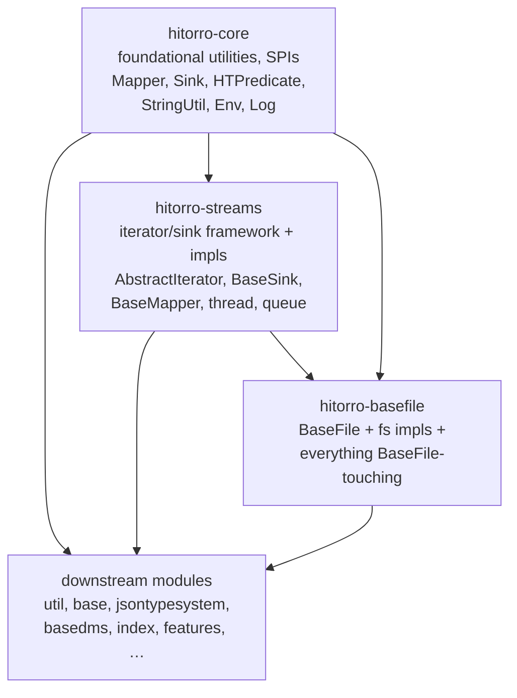
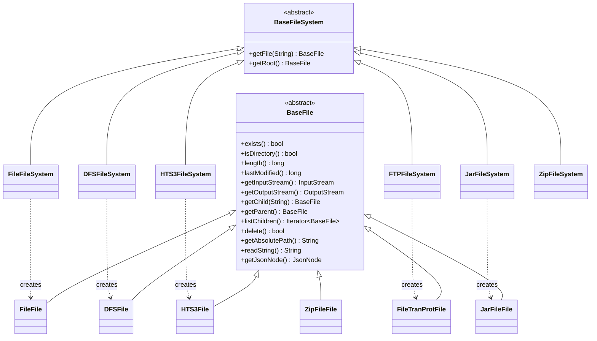

# hitorro-basefile

Pluggable filesystem abstraction for the HiTorro family, plus everything that
streams **over** a `BaseFile`.

`BaseFile` is HiTorro's uniform handle to a file-like resource: it looks the
same whether the backing store is your local disk, S3, HDFS, an FTP server,
or an entry inside a jar. On top of that abstraction the module ships file
filters, directory crawlers, transacting-directory tools, a block-file queue
reader/writer subsystem, CSV readers/writers, image manipulation, URL parsing,
large-data streaming — anything in HiTorro that reads or writes a `BaseFile`
lives here.

## Position in the HiTorro dependency graph



The rule the split enforces:

- **`hitorro-core`** — no knowledge of `BaseFile` or the iterator framework
- **`hitorro-streams`** — no knowledge of `BaseFile`; pure iterators / sinks / mappers / threads
- **`hitorro-basefile`** — everything BaseFile-adjacent, free to use anything from core + streams

Downstream modules that need a `BaseFile` add `hitorro-basefile` as an explicit
Maven dep.

## The `BaseFile` abstraction



Constructing one:

```java
// local disk
BaseFile local = FileFileSystem.Root.getFile("/var/data/report.pdf");

// S3
BaseFile s3 = new HTS3FileSystem("us-east-1", "my-bucket").getFile("logs/2026-08.jsonl");

// HDFS
BaseFile hdfs = new DFSFileSystem(hadoopConf).getFile("/user/chris/big-input.avro");

// same code from here on — the API is uniform:
if (bf.exists()) {
    try (InputStream is = bf.getInputStream()) { ... }
}
```

## Package layout

```
com.hitorro.util.basefile/
├── fs/                         BaseFile, BaseFileSystem, FileInfo, FileAdapter,
│   │                           CompressionType, FileSystemCascadingContainer
│   ├── file/                   local-disk impl (FileFile, FileFileSystem)
│   ├── s3/                     S3 (HTS3FileSystem, S3CompatibleFileSystem)
│   ├── dfs/                    Hadoop DFS (DFSFile, DFSFileSystem)
│   ├── ftp/                    FTP (FileTranProtFile, FTPFileSystem)
│   ├── jarfile/                jar & zip (JarFileFile, JarFileSystem, ZipFileSystem)
│   ├── sinks/                  BaseFileStatsSink, HashCountingBaseFileStateSink, …
│   └── configfactories/        BaseFilePropertyFactory, FileConfig, FilePropertyFactory
├── filters/                    FileFilterBase + FileExtension, GlobFilter, IsDir,
│                               FileMatcher, FileNameContains, FileStartsWith, …
├── tools/
│   ├── crawler/                BaseFileCrawler + callback + DirectoryEnumerator
│   ├── direnum/                DirDateEnumerator, DirEnumUtil, DateEnumAction, PrintAction
│   ├── dirreplicator/          DirectoryReplicator + CopyStatus
│   ├── transactiondir/         TransactingDirectory + TransactingFile
│   ├── queue/reader/           StreamingDirectoryVisitorIterator, DirRow, FileComparator,
│   │                           GoodFileKeyWriter, EndFileNotification, WalkerDeserializer
│   ├── queue/writer/           BlockFileQueueWriter (BaseSink of records),
│   │                           DirectoryStep (Sorter/Merger), BaseFileToQueueStructureMover
│   ├── BaseFileUtil            large collection of BaseFile helpers (iterators, sinks, JSON)
│   ├── BaseFileMapperMapper    Mapper<BaseFile, BaseFile>
│   ├── BaseFileCSV2CSVIteratorMapper
│   ├── EnvBaseFiles            BaseFile-returning helpers (getBinConfigBaseFile, …)
│   └── MapUtilCSV              CSV loaders extracted from MapUtil

com.hitorro.util.io/
├── csv/                        CSVReader, CSVReaderBase, CSVIteratorImpl, CSVSink,
│                               ColumnTableMeta, CSVConsumer, StatisticsTable, CSVQuery
├── largedata/                  BaseFileAccessingObjectFactory, BaseFileComparator,
│                               BaseFileBucketWriter, CompressedStreamFileBucketWriter,
│                               CompressedIOSink, CompressedIOIteratorMapper,
│                               CompressedStreamSelectTreeController, aggregator/*
├── compressedmap/              CompressedPointerMap, CompressedPointerMapQuery
└── ImageManipulator            EXIF-aware resize/rotate using metadata-extractor

com.hitorro.util.core.iterator/
├── JarFileIterator             BaseFile-typed jar iterator
├── helpers/BaseFileIterators   iterator helpers over BaseFile
├── json/BaseJsonIterator       JSON iteration from a BaseFile source
└── sinks/JsonSink, JacksonVSSink, JSONSinkAsArray

com.hitorro.util.core.classes/
├── ClassPathDeepIterator, ClassPathShallowIterator - iterators over classpath entries
├── ClassFactory                                     - reflection-driven instantiation
└── ImplementationRegistry                           - symbolic-name → class-name registry

com.hitorro.util.urlparser/
└── TLDDictionary, TLDDictionarySingleton, UrlNormalizer

com.hitorro.util.testframework/
└── TestPlus                    - test-support interface with BaseFile-typed
                                  input/output-tree helpers

com.hitorro.util.json/
├── keys/BasefileProperty       - a JsonInitableProperty wrapping BaseFile
├── keys/mappers/BasefileMapper
├── iterators/                  JSON-doc iterators
└── mapper/                     JsonInitable mappers

com.hitorro.util.core.math/     SparseCounter, SparseCounterSet (BaseFile-backed)
com.hitorro.util.core.map/      FPHashLongMap, MapMapCSVLoader, TroveMapUtil (all BaseFile-aware)
com.hitorro.util.core.valuemap/ DomainValueNestFromFileCache
com.hitorro.util.core.http/     JSONHTTPIterableClient
```

## Block-file queue subsystem

One of the larger internal subsystems. Combines the iterator framework with `BaseFile`
to build a durable, block-formatted, sorter-friendly queue on disk:


- `BlockFileQueueWriter` (a `BaseSink`) writes records to block files under a directory
- `SorterDirectoryStep` sorts each block; `MergerDirectoryStep` merges sorted blocks
- `StreamingDirectoryVisitorIterator` reads sorted+merged output back as an
  `AbstractIterator`
- Everything is `BaseFile`-typed so the same subsystem runs against local disk,
  S3, or HDFS

## Building

```bash
# from the reactor root
mvn install -DskipTests -pl hitorro-basefile -am

# just this module (assumes hitorro-core and hitorro-streams are in ~/.m2)
cd hitorro-basefile
mvn install -DskipTests
```

Java 21 is required.

## Dependencies

| Kind | Group / artifact | Why |
|------|------------------|-----|
| Internal | `com.hitorro:hitorro-core` | Log, Env, StringUtil, HTAssert, JsonInitable, SPI interfaces |
| Internal | `com.hitorro:hitorro-streams` | AbstractIterator, BaseMapper, BaseSink, RestartableService, ThreadTimer |
| Runtime | `com.fasterxml.jackson.core:jackson-databind` | JsonInitable config, `BaseFile.getJsonNode()` |
| Runtime | `org.apache.hadoop:hadoop-client` | `DFSFileSystem` for HDFS |
| Runtime | `org.apache.hadoop:hadoop-aws` | `HTS3FileSystem` / `S3CompatibleFileSystem` |
| Runtime | `commons-net:commons-net` | `FTPFileSystem` |
| Runtime | `commons-codec:commons-codec` | file-content digests |
| Runtime | `com.drewnoakes:metadata-extractor` | `ImageManipulator` EXIF-aware operations |
| Runtime | `net.sf.trove4j:core` | `FPHashLongMap`, `TroveMapUtil` |
| Test | `junit-jupiter`, `mockito-core`, `assertj-core` | via reactor |

Consumers of BaseFile-backed code get all of this transitively.

## Adding a new filesystem

1. Extend `BaseFileSystem` (create + get root + get named file)
2. Extend `BaseFile` (exists/isDir/length/lastModified, in/out streams,
   getChild / getParent / listChildren, delete, absolutePath)
3. Register a `BaseFilePropertyFactory` if the FS needs config-driven bootstrap
4. Wire into `FileSystemCascadingContainer` if you want the FS to participate
   in URL-scheme dispatch (`s3://…`, `hdfs://…`, `ftp://…`)

## `EnvBaseFiles` — the config-directory shortcut

`EnvBaseFiles` (in `basefile.tools/`) provides BaseFile-returning helpers that
used to live on `Env`:

```java
BaseFile config = EnvBaseFiles.getBinConfigBaseFile();  // $HT_BIN/config
BaseFile types  = config.getChild("types");             // $HT_BIN/config/types
BaseFile home   = EnvBaseFiles.getHomeConfigBaseFile(); // $HT_HOME/config
BaseFile data   = EnvBaseFiles.getDataBaseFile();       // $HT_BIN/data
```

These moved off `Env` (in `hitorro-streams`) so streams doesn't have to import
`BaseFile`.

## History

Extracted from `hitorro-core` and `hitorro-streams` in the
`pre-basefile-extraction-2026-08-12` refactor. Before the split, BaseFile lived
in `hitorro-core` and BaseFile-consuming code was scattered across `hitorro-streams`
and `hitorro-core`; after the split, all BaseFile-related code lives here and
the dep direction is `core → streams → basefile`.

## License

MIT (see the parent `hitorro-all` repo).
